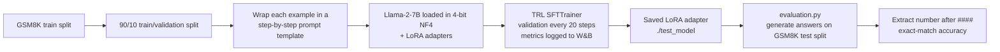

# LLaMA-2 Fine Tuning on GSM8K

This project fine-tunes Meta's **Llama-2-7B** on **GSM8K**, a dataset of grade-school math word problems. The goal is to have the model reason step by step before giving a final numeric answer.

Training uses **QLoRA**: the base model is loaded in 4-bit precision and stays frozen, and only small LoRA adapter layers are trained. This lets a 7B-parameter model be fine-tuned on a single GPU. A separate script then evaluates the fine-tuned model on the GSM8K test set using exact-match accuracy.

## Results

| Metric | Value |
|---|---|
| Test accuracy (GSM8K test split, exact match) | **14.405%** |
| Training loss | \~1.63 &rarr; \~0.67 |
| Validation loss | settled near \~0.70 |

- Both losses dropped quickly in the early steps and flattened after roughly 100 steps (about 3 epochs).
- Training and validation loss stayed close throughout, with no visible sign of overfitting.
- Curves were tracked in Weights & Biases.

## How It Works



### 1. Data preparation (`fine-tuning.py`)

The GSM8K `main` training split is loaded from Hugging Face and split 90/10 into training (6,725 examples) and validation (748 examples) sets.

Each question–answer pair is turned into a single training string with a chain-of-thought instruction:

```text
Question:
 {question}

 Let's think step by step. At the end, you MUST write the answer as an integer after '####'.

 Answer:
 {answer}
```

GSM8K reference answers already contain worked solutions ending in `#### <number>`. The model therefore learns both the reasoning style and the answer format, which the evaluation script depends on.

### 2. 4-bit quantization

The base model is loaded through `bitsandbytes` with:

- **4-bit NF4** weights (`bnb_4bit_quant_type="nf4"`)
- **Double quantization** enabled, which also compresses the quantization constants
- **float16** compute dtype

`prepare_model_for_kbit_training()` from PEFT then prepares the quantized model for training. The KV cache is disabled during training (`use_cache=False`).

### 3. LoRA adapters

LoRA adapters are attached to **all attention and MLP projection layers**, not only the attention layers:

| Setting | Value |
|---|---|
| Target modules | `q_proj`, `k_proj`, `v_proj`, `o_proj`, `gate_proj`, `up_proj`, `down_proj` |
| Rank (`r`) | 16 |
| `lora_alpha` | 32 |
| Dropout | 0.05 |
| Bias | none |
| Task type | `CAUSAL_LM` |

Only these adapter weights are trained. The 4-bit base weights stay frozen.

### 4. Supervised fine-tuning

Training uses TRL's `SFTTrainer`:

| Setting | Value |
|---|---|
| Epochs | 5 |
| Per-device batch size | 20 (train and validation) |
| Gradient accumulation | 10 steps (effective batch size 200) |
| Optimizer | `paged_adamw_8bit` |
| Learning rate | 1e-4, linear decay, 10 warmup steps |
| Max sequence length | 512 tokens |
| Validation | every 20 steps |
| Logging | every step, to Weights & Biases |

After training, only the LoRA adapter is saved, to `./test_model`.

### 5. Evaluation (`evaluation.py`)

1. Reads the adapter config to find the base model, loads that model in 4-bit (same settings as training), and attaches the trained adapter.
2. For each of the 1,319 questions in the GSM8K `test` split:
   - builds the same prompt as training, without the answer;
   - generates up to 150 new tokens (`temperature=0.1`, `top_p=0.5`).
3. Extracts the predicted answer from the generated text after `####`, removes commas, `$`, `%` and the letter `g`, and compares it as a string with the reference answer.
4. Prints overall test accuracy.

## Tech Stack

- **Model:** `meta-llama/Llama-2-7b-hf`
- **Dataset:** `openai/gsm8k` (`main` config)
- **Libraries:** PyTorch, Hugging Face Transformers, Datasets, PEFT, TRL, bitsandbytes, Weights & Biases, tqdm

## Getting Started

### Clone the Repository

```bash
git clone <your-repo-url>
cd <your-repo-folder>

pip install torch transformers datasets peft trl bitsandbytes accelerate wandb python-dotenv tqdm dotenv
```

### Configuration

API keys are read from a `.env` file, which git ignores:

```bash
cp .env.example .env
```

Then fill in `.env`:

| Variable | Used by | Purpose |
|---|---|---|
| `HF_TOKEN` | both scripts | Downloads the gated Llama-2 model and the dataset |
| `WANDB_API_KEY` | `fine-tuning.py` | Logs training and validation metrics to W&B |

## Usage

**Train the adapter:**

```bash
python fine-tuning.py
```

Checkpoints go to `./results`, and the final LoRA adapter is saved to `./test_model`.

**Evaluate on the GSM8K test set:**

```bash
python evaluation.py
```

Run this from the same folder, because it loads the adapter from `./test_model`.

The script prints:

```text
CUDA available: True
Testing Accuracy: XX.XXX %
```

Hyperparameters and paths are set in the `ModelConfig` class (`fine-tuning.py`) and the `TestConfig` class (`evaluation.py`).

## Project Structure

```text
.
├── fine-tuning.py   # QLoRA fine-tuning of Llama-2-7B on GSM8K
├── evaluation.py    # Exact-match accuracy on the GSM8K test split
├── .env.example     # Template for HF_TOKEN and WANDB_API_KEY
├── .gitignore       # Keeps .env, model outputs and logs out of git
├── README.md
└── LICENSE
```

## Team Contributions

**Viknesh Rajaramon**: SFT training configuration (`SFTConfig`), `SFTTrainer` setup, and the `main()` pipeline that connects the training workflow

**Vignesh Gopalakrishnan**: Training hyperparameters and the validation process

**Kalhan Ganjoo**: Library setup and the PEFT/LoRA configuration

**Lalit Arvind Balaji**: 4-bit quantization and model/tokenizer loading

**Akash Sivakumar**: Dataset loading, preprocessing and prompt template, and W&B integration

## References

**Llama-2 Model**

**GSM8K Dataset**

**PyTorch Documentation**

## License

This project is licensed under the MIT License. See the LICENSE file for details.
